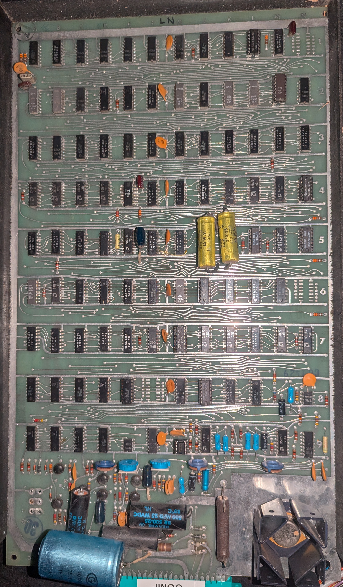

# Atari 'World Cup' (WCC/Goal IV) FPGA Recreation

This project is a VHDL recreation of the classic 1974 discrete logic arcade game known as 'World Cup', 'World Cup Football', 'Coupe du Monde' or 'Goal IV' by Atari. The original PCB is marked 'WCC' and was assigned the working ID 'TM-035'.

> **Status, 26 October 2026: all major gameplay circuits integrated; latest hardware verification remains open.**
> Hit-driven acceleration and the pin-7 credit lamp are implemented. The latest acceleration build passed 15 automated stages and flash verification; physical confirmation of that image is pending. The build-sensitive catch fault and incomplete FPGA timing coverage remain open. See the [prioritized next steps](docs/IMPLEMENTATION_PLAN.md) and [verification record](docs/VERIFICATION_STATUS.md).

## Current Implementation Status

| Phase | What | Status |
|-------|------|--------|
| Phase 0 | Foundation: clock, H/V sync, sync summing | **Done** |
| Phase 1 | Playfield circuit (Fig 9) | **Done** |
| Phase 2 | Game control: electronic latch, credit, start, game select, time line, serve timing | Coin/start, attract, two-minute timer and serve integrated and simulation-tested; runtime one-/two-player selection (board defaults to two-player); analogue models remain |
| Phase 3 | Ball system: motion, direction & speed, catch/kick, window/miss/bounce | Integrated; hit-driven acceleration and Figure 15 decoder corrections pass RTL and local fitted timing checks. Latest-image hardware confirmation remains pending |
| Phase 4 | Players: all forwards, defense/goalie (solid + striped), ramp, mux, summing | Integrated; player spacing and analog-model fidelity remain audit items |
| Phase 5 | Score circuit, sound circuit, moving hole | Score circuit implemented and integrated; **goal counting FPGA-tested and confirmed working on 18 October 2026** (see [verification](docs/SCORE_ROLLOVER_TIMING.md)); sound (Fig 20) implemented, integrated and simulation-tested; **moving-hole reversal (Fig 18) corrected and simulation-tested on 22 October 2026; specific fitted timing and commit/hash-linked hardware verification remain open** (see [notes](docs/MOVING_HOLE_FIG18.md)) |
| Phase 6 | Video output and board integration | Board wrapper, PLL and composite output integrated; synthesis/fitting passed and hardware video tested. Original Fig 22 resistor network recreation remains outstanding |

See [AGENTS.md](AGENTS.md) for the full circuit-by-circuit breakdown.

### One-player mode — complete

One-player mode is **complete**, as confirmed by the project owner on
26 October 2026. It provides the solid left goalie and two solid forwards,
with no solid defenders or checked players, and the moving goal opening.
The missing Figure 11 player-window mode connection has been corrected and
regression-tested; the default two-player paid-play screenshot is unchanged.

**Moving-hole reversal is corrected in simulation.** The owner-approved change
on 22 October 2026 selects 6/8 presets, producing 314/312-line recurrence against
the 313-line raster: one line down or up per frame. The previous 9/11 presets
produced 311/309-line recurrence, so both settings moved upward. An explicit
LS74 sampling stage now captures the settled playfield boundary, preventing a
ripple-counter transient from causing an early upper reversal.

The actual-raster regression checks 998 complete fields: the opening remains
16 scanlines high, moves between start lines 83 and 224, and repeatedly reverses
without wrapping or disappearing. The standard 650 ms full-core simulation also
passes, with its PNG and GIF visually inspected; repeated reversals are checked
by the longer focused fixture. This is an approved FPGA adaptation: the manual's
6/8 prose conflicts with Figure 18's 9/11 wiring, and boundary sampling is added
logic. See the [correction and verification record](docs/MOVING_HOLE_FIX_PROPOSAL.md).

Mode selection uses the active-low `GameSelect_I` port on the core and board
wrapper: low selects one player, high selects two players. Connect the JAMMA
TEST signal to this port. Selection is debounced for 5 ms; attract always uses
two-player mode through Figure 10 C5 gating. A momentary switch selects one
player only while held; use a maintained switch for persistent selection.
The checked-in board wrapper assigns `GameSelect_I` to FPGA pin 41 with a pull-up.
The owner's completion confirmation is recorded separately from the long RTL
fixture and fitted timing evidence. Detailed timing coverage and image-linked
sweep measurements remain verification tasks, not missing one-player features; see the
[verification record](docs/VERIFICATION_STATUS.md).

See the [historical one-player handoff](docs/ONE_PLAYER_HANDOFF.md)
and [Figure 18 wiring and timing notes](docs/MOVING_HOLE_FIG18.md).

## Project Goals and Methodology
- The VHDL code is designed to closely resemble the original schematics for maximum traceability and historical accuracy.
- All standard TTL logic is implemented as 74 series ICs (e.g., LS02, LS04, etc.) and saved in the `74LS` directory.
- Other ICs are saved in the `IC` directory.
- Each IC is defined as a VHDL entity, with ports and instance names matching the real IC pinout and PCB location.
- Pin connections in port maps are labeled to reflect both the pin number and the signal it connects to, aiding cross-referencing with the schematic.
- Individual VHD files will be created to represent each circuit as described by the manual.
- The file [Goal_IV_TM-035.pdf](Goal_IV_TM-035.pdf) is the original manual and schematics.
- [Goal_IV_TM-035_ocr.pdf](Goal_IV_TM-035_ocr.pdf) was created with OCR and adds metadata to the original PDF to make it searchable.
- [Goal_IV_TM-035.md](Goal_IV_TM-035.md) is a markdown file generated from the OCR process and further adjusted.

## Architecture

The design mirrors how the original 1970s hardware would work: discrete 74LS-series TTL ICs wired together at the gate/flip-flop level. Schematic-defined TTL logic must use **direct entity instantiation** (`entity work.LS04` etc.) for traceability and GHDL compatibility. The current implementation still includes behavioral models for analog functions and top-level miss qualification, plus FPGA sampling adapters and direct video-combining logic; these are exceptions to the intended gate-level fidelity.

## Tooling
- Quartus II version 13.0.1 Service Pack 1 for synthesis.
- **GHDL** 0.37+ (mcode or LLVM backend) for simulation.
- **Python 3** with `Pillow` for image generation and optional `pygame` for interactive display.

## Routine build and programming

Use `./scripts/build_and_test.py` for an isolated build, routing/timing guards,
regressions and video capture. Review its summary and images, then use
`./scripts/program_as.py <exact-run-image.pof>` when programming is requested.
See [build automation](docs/BUILD_AND_TEST.md) and [Active Serial programming](docs/ACTIVE_SERIAL_PROGRAMMING.md).

LED0 on pin 3 retains the catch diagnostic: either kick button in one-player
mode, STOP in two-player mode. Pin 7 drives the active-low Figure 8 credit lamp.
Sound remains enabled. See [credit LED](docs/CREDIT_LED.md).

## Running the Simulation

```bash
cd sim
bash run_sim.sh                # Two players (default)
ONE_PLAYER=1 bash run_sim.sh   # One player
```

This compiles the simulation sources, runs for **650 ms** by default, and calls the Python visualizer. Override the duration with, for example, `STOP_MS=900 bash run_sim.sh`. Output:

- `frame_data.txt` - Raw samples: `HSYNC VSYNC HBLANK VIDEO` captured at 7.142857 MHz (matching the current board clock)
- `frame_attract.png`, `frame_credit.png`, `frame_serve.png`, `frame_play.png`, `frame_game_over.png` - Control-sequence keyframes
- `frame_output.png` - Copy of `frame_play.png` (index 20, 2x scale, green phosphor)
- `gameplay.gif` - Animated GIF of all complete frames (generated when >2 frames captured)
- `frame_output.ppm` - Written with `--ppm`, or as a fallback when `pygame` is unavailable

The testbench inserts a coin, presses Start, and checks return to attract. It accelerates the game to 300 ms and serve/catch delays to 50 ms; board defaults remain two minutes and three seconds. Control regressions: `bash sim/run_control_tests.sh`.

Requires Python 3 with `Pillow`: `pip3 install Pillow`

For VCD waveform debugging, add `--vcd=atari_wcc.vcd` to the GHDL run command in `run_sim.sh`.

Moving-hole regression tests can be run from the repository root with
`bash sim/run_moving_hole_tests.sh`. They cover the IC models, preset periods,
boundary reversal and mode selection, including a comparison of raw and sampled
playfield boundaries. The suite generates `sim/moving_hole_timing.png`, `sim/moving_hole.gif`,
and `sim/moving_hole_raster.png` / `.gif`.

Sound regression tests can be run from the repository root with `bash sim/run_sound_tests.sh`. See [Figure 20 sound circuit notes](docs/SOUND_CIRCUIT_FIG20.md) for coverage and timing estimates.

## Board Build and Hardware Status

Use `atari_wcc_board` as the Quartus top-level for the Cyclone II EP2C5T144C8:

```bash
quartus_sh --flow compile atari_wcc
```

The board's 50 MHz oscillator feeds a PLL configured for **14.285714 MHz** (multiply 2, divide 7), giving a **7.142857 MHz** pixel clock. This is approximately 0.2268% slower than the original 14.318180 MHz master clock; the simulation testbench uses the same 70 ns period as the board configuration.

The wrapper uses the Sprint2/MaSTer composite-video connections and an external resistor network. The latest recorded acceleration build (24 October) uses **3,113/4,608 logic elements (68%)** and 619 registers. Ball, score and B6 speed routing/setup/hold checks pass. Whole-design timing remains incomplete; the 22 October report's 32 unconstrained clocks is a historical count, not a fresh inventory of this image. See [current verification](docs/VERIFICATION_STATUS.md).

Sound output is connected to `Audio1_O` on **FPGA pin 71**. Sound and attract muting are simulation-tested; M9 hit-sound timings remain adjustable estimates. A specific listening/calibration result should be recorded against the tested bitstream. See [sound implementation and validation](docs/SOUND_CIRCUIT_FIG20.md) and the [current verification record](docs/VERIFICATION_STATUS.md), which distinguishes current image hashes from historical provenance limits.

See [board clock, pinout and build details](docs/MASTER_CLOCK_AND_VIDEO_ADOPTION.md).

## Coin, Start and Attract Mode

Power-up enters silent attract mode with closed goals and fixed player positions. Insert a coin, release it, then press Start to begin a **two-minute game** in the selected one- or two-player mode (two players by default). One coin enables one game; expiry returns to attract and retains the scores.

The board uses Sprint2's `Coin1_I` on **pin 120** and `Start1_I` on **pin 112**, both normally-open switches to GND with FPGA weak pull-ups. A two-stage synchronizer and 5 ms debounce adapt these single-contact inputs to the original changeover-switch latch behavior. The game circuitry then qualifies the coin and generates START/ATRC through Figure 8's TTL logic.

See [JAMMA input and game-control implementation](docs/JAMMA_GAME_CONTROL.md) for the schematic boundary and circuit tests. The owner reports playable hardware; record detailed coin/start and other board observations with the commit and bitstream hash as described in the [verification record](docs/VERIFICATION_STATUS.md).

## Documentation

- [Next steps](docs/IMPLEMENTATION_PLAN.md) - Prioritized work queue and remaining fidelity work
- [Verification status](docs/VERIFICATION_STATUS.md) - RTL results, local fit reports and hardware evidence
- [AGENTS.md](AGENTS.md) - Agent instructions, circuit inventory and style guide
- [docs/](docs/) - Build documentation, timing analysis, and implementation notes

## Atari WCC PCB

### IC Layout

Predominantly 74 series ICs.
The UA747 at F9 and N9 are opamps so are not implemented.

|       | A  | B  | C  | D  | E  | F  | H  | J  | K  | L  | M  | N  |
| -----:|:--:|:--:|:--:|:--:|:--:|:--:|:--:|:--:|:--:|:--:|:--:|:--:|
| **1** | [04](74LS/LS04.vhd) | [20](74LS/LS20.vhd) | [93](74LS/LS93.vhd) | [93](74LS/LS93.vhd) | [93](74LS/LS93.vhd) | [93](74LS/LS93.vhd) | [107](74LS/LS107.vhd) | [00](74LS/LS00.vhd) | [74](74LS/LS74.vhd) | [30](74LS/LS30.vhd) | [08](74LS/LS08.vhd) |  - |
| **2** | [10](74LS/LS10.vhd) | [107](74LS/LS107.vhd) | [30](74LS/LS30.vhd) | [74](74LS/LS74.vhd) | [74](74LS/LS74.vhd) | [86](74LS/LS86.vhd) | [10](74LS/LS10.vhd) | [04](74LS/LS04.vhd) | [10](74LS/LS10.vhd) | [10](74LS/LS10.vhd) | [48](74LS/LS48.vhd) | [107](74LS/LS107.vhd) |
| **3** | [20](74LS/LS20.vhd) | [107](74LS/LS107.vhd) | [00](74LS/LS00.vhd) | [08](74LS/LS08.vhd) | [04](74LS/LS04.vhd) | [02](74LS/LS02.vhd) | [27](74LS/LS27.vhd) | [00](74LS/LS00.vhd) | [90](74LS/LS90.vhd) | [90](74LS/LS90.vhd) | [153](74LS/LS153.vhd) | [153](74LS/LS153.vhd) |
| **4** |[9316](IC/IC9316.vhd)|[9316](IC/IC9316.vhd)|[9316](IC/IC9316.vhd)|[9316](IC/IC9316.vhd)| [74](74LS/LS74.vhd) | [02](74LS/LS02.vhd) | [02](74LS/LS02.vhd) | [20](74LS/LS20.vhd) | [107](74LS/LS107.vhd) |[9316](IC/IC9316.vhd)|[9316](IC/IC9316.vhd)| [27](74LS/LS27.vhd) |
| **5** | [86](74LS/LS86.vhd) | [83](74LS/LS83.vhd) | [08](74LS/LS08.vhd) | [74](74LS/LS74.vhd) |[9602](IC/IC9602.vhd)| [08](74LS/LS08.vhd) | [02](74LS/LS02.vhd) |[9602](IC/IC9602.vhd)|  - | [74](74LS/LS74.vhd) | [86](74LS/LS86.vhd) | [00](74LS/LS00.vhd) |
| **6** | [08](74LS/LS08.vhd) |[9316](IC/IC9316.vhd)| [04](74LS/LS04.vhd) | [74](74LS/LS74.vhd) | [86](74LS/LS86.vhd) | [00](74LS/LS00.vhd) | [10](74LS/LS10.vhd) | [27](74LS/LS27.vhd) | [08](74LS/LS08.vhd) | [86](74LS/LS86.vhd) | [92](74LS/LS92.vhd) |  - |
| **7** | [83](74LS/LS83.vhd) | [02](74LS/LS02.vhd) | [86](74LS/LS86.vhd) |[9314](IC/IC9314.vhd)| [20](74LS/LS20.vhd) | [107](74LS/LS107.vhd) | [153](74LS/LS153.vhd) |[9316](IC/IC9316.vhd)|[9316](IC/IC9316.vhd)| [153](74LS/LS153.vhd) |[9316](IC/IC9316.vhd)|[9316](IC/IC9316.vhd)|
| **8** | [04](74LS/LS04.vhd) | [74](74LS/LS74.vhd) | [00](74LS/LS00.vhd) | [74](74LS/LS74.vhd) | [00](74LS/LS00.vhd) |  - | [107](74LS/LS107.vhd) | [04](74LS/LS04.vhd) | [02](74LS/LS02.vhd) | [00](74LS/LS00.vhd) |  - | 555 |
| **9** | [74](74LS/LS74.vhd) | [74](74LS/LS74.vhd) | [02](74LS/LS02.vhd) | [04](74LS/LS04.vhd) | 555 | 747 | 555 |[9602](IC/IC9602.vhd)|  - |  - |[9602](IC/IC9602.vhd)| 747|

### PCB Image



### Playfield Layout (Reference Coordinates)
```
0, 140 to 144,     404 to 408, 548
 ______________________________   0
|    ______________________    |
|   |  __________________  |   |  80 to 84
|   | |                  | |   |
|   |_|                  |_|   |  128
|                              |
|                              |  162
|    _                    _    |
|   | |                  | |   |  196
|   | |__________________| |   |
|   |______________________|   |  240 to 244
|______________________________|
                                  324
```
